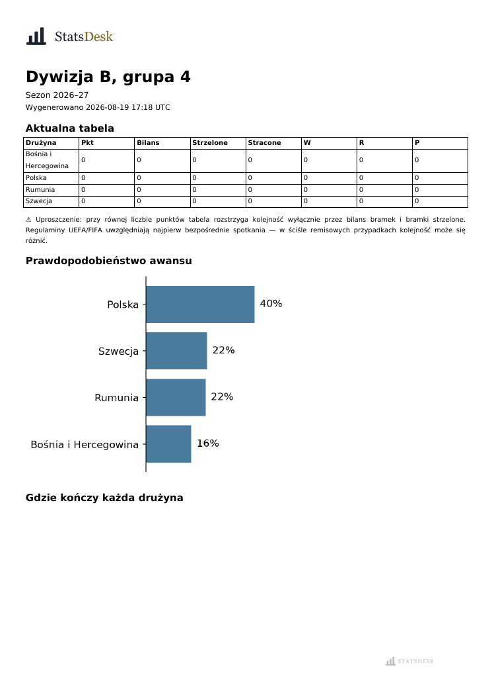
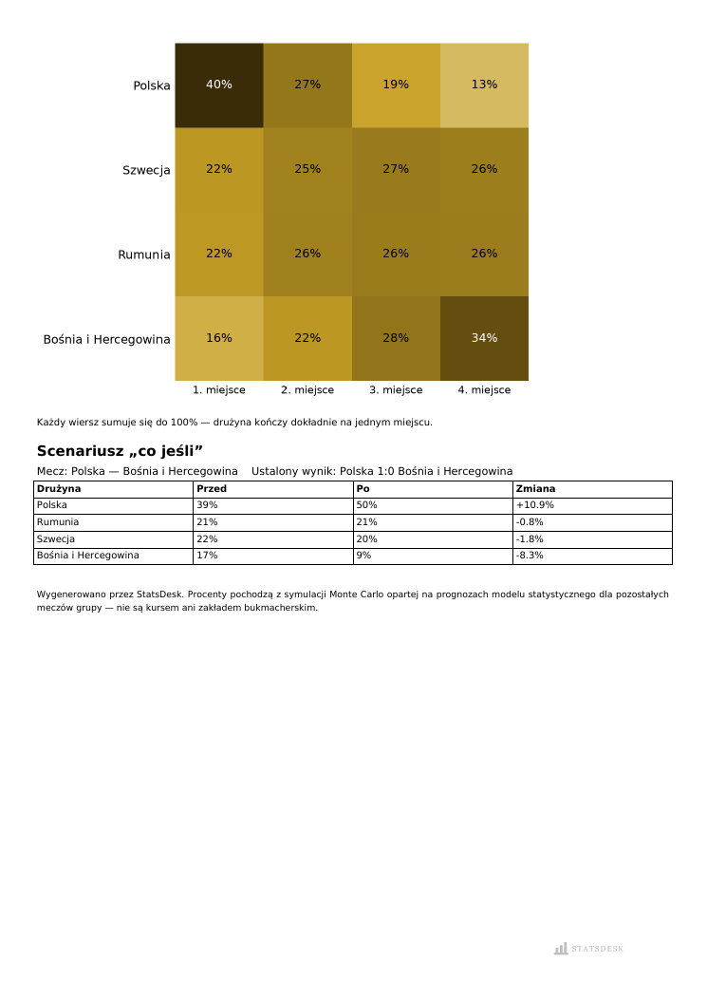

# football_ai

A leak-safe machine-learning pipeline for predicting international football
matches: 1X2 outcome, goals, xG, and (where licensed data allows) match
statistics, followed by Monte Carlo simulation of group and tournament
outcomes.

The emphasis is on the engineering around the model: time-aware validation,
explicit leakage audits, provenance-tracked data, and honest handling of
missing or unlicensed data, rather than on squeezing out the last point of
accuracy.

## Example output

Monte Carlo outlook for UEFA Nations League 2026-27, League B, Group 4:
finishing-position distribution from 10,000 simulated seasons, and a
"what if" scenario with a fixed result. Probabilities come from the trained
models' predicted goals, sampled as Poisson scorelines (not 1X2 classes),
because qualification is decided on goal difference.

<p>
  
  
</p>

> These samples were generated before the final retraining run
> (see "Engineering notes" below), so the numbers are illustrative.
> The report text is in Polish; the codebase and docs are in English.

## What is in here

| Layer | Package | Notes |
|---|---|---|
| Data collection | `football_ai/scrapers` | martj42 results (1872-present), Elo ratings, StatsBomb open data, Football-Data, Open-Meteo, tournament squads (footballcsv/footballsquads) |
| Data quality | `football_ai/data_quality` | integrity validators, coverage report, per-record provenance and license-status checks |
| Features | `football_ai/features` | leak-safe rolling / recency / head-to-head features, Elo, squad indices (age, height, continuity, club cohesion) |
| Models | `football_ai/models` | Random Forest, LightGBM, CatBoost, XGBoost, stacking ensemble, joblib artifacts and a model registry |
| Training | `football_ai/training` | chronological splits, Optuna tuning with rolling CV, probability calibration |
| Inference | `football_ai/predictions`, `football_ai/api` | feature builder shared with training, FastAPI service |
| Simulation | `football_ai/simulation` | Poisson-scoreline Monte Carlo, group tables, what-if scenarios |
| Facts | `football_ai/insights` | streaks, records, head-to-head, each fact carries the list of matches it was derived from |
| Narrative | `football_ai/narrative` | deterministic templates (no LLM-generated facts) |
| App | `football_ai/streamlit_app.py` | match preview, group outlook, PDF export |

## Engineering notes

**No random splits, anywhere.** All splitting lives in
`training/splitters.py` (a single chronological 70/15/15 cut and rolling
positional folds). Optuna's objective and the stacking ensemble both build
their `cv=` from those splitters, since scikit-learn's default
(Stratified)KFold would silently reintroduce time-series leakage.

**Leakage audits with regression tests.** Several real leaks were found and
fixed by auditing the feature set, each pinned by a test:

- the current match's own score and cards reaching the feature set
- a same-name merge collision that leaked post-match stats
  (`_wide_merge` now drops engineered columns that shadow source columns)
- a home/away label leak on neutral ground: rolling features now treat both
  teams as "away" at neutral venues, and the raw `is_home` flag and
  `home_team_name`/`away_team_name` categoricals were removed from the
  features. A full-pipeline test asserts that relabelling home and away on a
  neutral-venue match yields mirrored feature rows.

**Run-to-run variance matters.** While verifying the neutral-ground fix, the
same training command on the same data gave opposite verdicts on one
fixture, traced to an unseeded Optuna sampler combined with too few trials on
a rare region of the data (large Elo gap on neutral ground). The lesson
recorded in the repo: do not pick a model because one run looked good.

**Honest about data rights.** Sources whose terms forbid ML use (for example
ESPN) are marked `FORBIDDEN` in the provenance layer. The corresponding match
statistics (corners, cards, shots, possession) are withdrawn rather than
predicted from data the project may not use, and the UI says so instead of
showing invented numbers.

**Training and serving share one feature code path.** The inference builder
re-runs `build_features` on history plus the single upcoming match, and the
serving layer logs a warning on any feature-schema drift against the trained
artifact.

The full engine plan and the history of decisions are in
[`docs/archive/ENGINE_PLAN.md`](docs/archive/ENGINE_PLAN.md).

## Quick start

Python 3.12 is required.

```bash
python3.12 -m venv .venv
source .venv/bin/activate
pip install -r requirements.txt
cp .env.example .env            # only needed for the optional live-fixtures source

python -m football_ai.scrapers.sources.international_results   # match history
python -m football_ai.scrapers.sources.elo
python -m football_ai.training.orchestrator --targets match_outcome,home_goals,away_goals --n-trials 20
uvicorn football_ai.api.main:app --reload                      # GET /health, POST /predict
streamlit run football_ai/streamlit_app.py
```

`requirements-local.txt` is a lighter set for code, API and test work without
training dependencies.

## Tests

```bash
python -m unittest discover football_ai/tests
```

Some tests are skipped when optional heavy dependencies (joblib, scikit-learn,
FastAPI, pydantic, SQLAlchemy, Streamlit) are not installed; a skip is not a
pass.

## Status

Personal portfolio project. The prediction engine and the layers above it are
implemented; the retraining of the final models after the leakage fixes is the
last open item, so no headline accuracy figures are published here yet.
Earlier plans for a commercial API are archived in `docs/archive/`.
